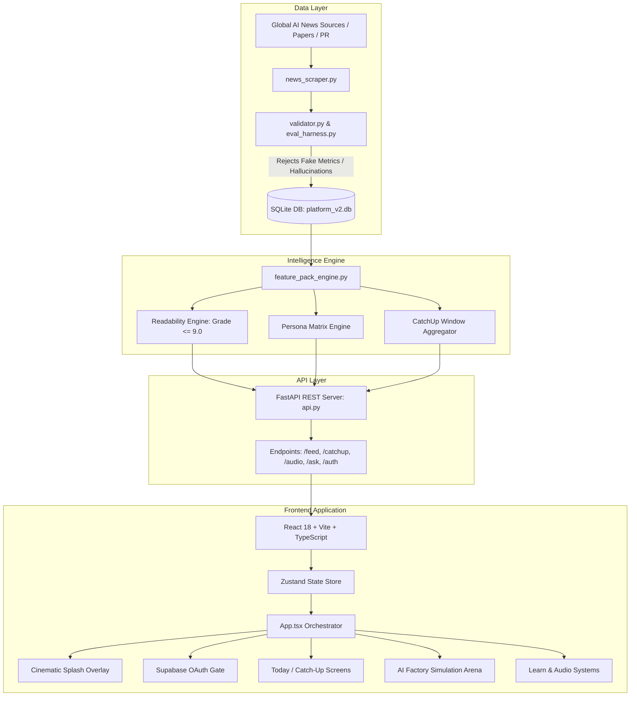

<div align="center">

  

  <p align="center">
    <strong>KNOW WHAT MATTERS TO YOU</strong>
  </p>

  <p align="center">
    <em>The intelligent noise-cancellation layer for modern artificial intelligence.</em><br />
    Verified daily intelligence, zero-hype capability benchmarks, and a 6-stage interactive neural network simulation.
  </p>

  <p align="center">
    <a href="#-core-architecture"></a>
    <a href="#-test-suite--quality-gates"></a>
    <a href="#-security--auth"></a>
    <a href="#-readability-guarantee"></a>
  </p>

  <br />

</div>

---

## ⚡ The Problem: The AI Hype Crisis

Every day, the world is inundated with thousands of AI headlines:
* Sensationalized benchmark charts with cherry-picked baselines.
* Vaporware announcements disguised as frontier breakthroughs.
* Dense academic papers gated behind impenetrable technical jargon.

**Most people don't need more AI noise. They need an honest, verified lens on what has actually changed.**

**DeHype** is an end-to-end intelligence platform engineered from the ground up to strip away the marketing fog, verify empirical shifts in machine capability, and teach users from first principles how modern artificial intelligence is *actually* engineered.

---

## 🌟 What We Built

### 1. 📰 The Anti-Hype Intelligence Feed (`Today` & `Catch-Up`)
An automated newsroom pipeline that ingests, verifies, simplifies, and categorizes AI developments across the globe:
* **Empirical Truth Verification:** Automated fact-checking against underlying research repositories, model weights, and live pricing data. Planted fake pricing and hallucinated capability claims are automatically rejected at the ingest gate.
* **Algorithmic Readability Gating:** Every headline and digest is passed through a natural-language simplification engine enforcing a **Flesch-Kincaid Grade Level $\le 9.0$**. Zero unearned jargon; pure conceptual clarity.
* **Persona-Tailored Lenses:** Dynamically adapt digest complexity and actionable takeaways for 4 distinct audiences:
  * 🎓 **Students:** Intuitive analogies, career impact, foundational concepts.
  * 🏫 **Educators:** Pedagogical implications, curriculum alignment, classroom policy.
  * 💼 **Entrepreneurs / Founders:** Unit economics, API costs, operational leverage.
  * 💻 **Engineers & Office Workers:** Architecture patterns, developer tooling, latency tradeoffs.
* **Temporal Catch-Up Windows:** Seamlessly switch between **Last 24 Hours**, **Past 7 Days**, and **Past 30 Days** to catch up without context-window fatigue.

### 2. 🎮 The AI Factory Simulation Arena
An interactive, 6-stage neural network development simulator that replaces abstract explanations with hands-on mechanics:
* **Stage 1 · Data Collection & Diet Balancing:** Drag and drop disparate datasets (Books, Code, Forums, Social, Spam) onto the intake belt. Watch model health plummet if given a biased, one-sided diet.
* **Stage 2 · Cleaning & Token Curation:** Inspect incoming tokens and filter noise, toxicity, duplicates, and formatting artifacts before compute allocation.
* **Stage 3 · Neural Weights & Overfitting Dynamics:** Feed iterative data batches into the model core. Experience the real danger of overfitting when recycling identical data batches.
* **Stage 4 · Behavioral Alignment (RLHF):** Choose alignment policies (Honesty, Uncertainty Admittance, Fact Verification) while resisting toxic engagement traps (Outrage farming, Sycophancy).
* **Stage 5 · Adversarial Stress Testing:** Subject the aligned model to live pressure prompts—evaluating mathematical baselines, hallucination traps, and guardrail resistance in a real-time terminal output stream.
* **Stage 6 · Release & Diagnostic HUD:** Measure core health, linguistic tone vectors, and deployability metrics before public release.
* *Engineered with a zero-WebGL, lightweight SVG Neural Mind Core for instantaneous 60fps performance across mobile and low-compute devices.*

### 3. 🎙️ Synchronized Audio Briefing
* Real-time sentence-by-sentence text-to-speech audio player.
* Active karaoke sentence tracking with scrubber controls, variable speed presets ($0.75\times$ to $2.0\times$), and instant jump-to-sentence navigation.

### 4. 🧠 Interactive Deep Learn Hub
* Comprehensive interactive masterclasses on the foundational pillars of frontier AI:
  * **Transformers & Attention Mechanisms**
  * **RAG (Retrieval-Augmented Generation)**
  * **MCP (Model Context Protocol)**
  * **Multi-Agent Orchestration Architectures**
  * **LLM Evaluation & Benchmark Rigging**
  * **Inference Latency vs. Throughput Economics**
* **Active Recall Engine:** Includes multi-depth selectors (*Brand New* $\to$ *Foundational* $\to$ *Under the Hood*), interactive knowledge verification quizzes, and explain-back retention loops.

### 5. 🛠️ Personal Workbench & In-Context Assistant
* **Story Vault:** Bookmark, archive, and categorize crucial capability shifts.
* **Retention Metrics:** Weekly visit tracking and reading progress rings.
* **Contextual Ask Drawer:** Slide-over AI assistant pre-loaded with contextual queries to dive deeper into any story without leaving the page.

---

## 🏗️ Core Architecture



---

## 🛠️ Technology Stack

| Layer | Technologies | Purpose |
| :--- | :--- | :--- |
| **Frontend** | React 18, Vite, TypeScript | Type-safe, ultra-fast single page application |
| **Styling** | Tailwind CSS, CSS Variables | Warm editorial aesthetic (`#FAF7F2`), dark mode support |
| **Motion** | Framer Motion | Physics-based spring animations, layout transitions |
| **State** | Zustand (with localStorage sync) | Lightweight atomic state for audio, personas, retention |
| **Backend** | Python 3.14+, FastAPI, Uvicorn | High-throughput asynchronous REST API |
| **Data Engine** | SQLAlchemy 2.0, SQLite (WAL mode) | Robust ACID relational persistence with cache invalidation |
| **Security & Auth** | Supabase (Google OAuth + Guest mode) | Production-grade JWT session authentication |
| **Verification** | Pytest, Flesch-Kincaid NLP | 100% automated gate enforcement |

---

## 🚀 Quick Start Guide

### Prerequisites
* **Node.js** (v18.0 or higher) & **npm**
* **Python** (v3.10 or higher)

### 1. Clone & Set Up the Backend
```bash
# Clone the repository
git clone https://github.com/your-username/ai-for-all.git
cd ai-for-all

# Create and activate virtual environment
python -m venv venv
# On Windows:
.\venv\Scripts\activate
# On Linux/macOS:
source venv/bin/activate

# Install dependencies
pip install fastapi uvicorn sqlalchemy pydantic pytest faker langsmith

# Run the backend test suite
pytest test_feature_pack.py
```

### 2. Start the FastAPI Server
```bash
uvicorn api:app --reload --port 8000
```
*API documentation will be live at `http://localhost:8000/docs`.*

### 3. Launch the Frontend
```bash
cd frontend

# Install packages
npm install

# Start Vite development server
npm run dev
```
*Open `http://localhost:5173` in your browser.*

---

## 🧪 Test Suite & Quality Gates

The platform enforces strict automated quality gates prior to any deployment:

```bash
pytest test_feature_pack.py -v
```

```text
test_feature_pack.py::test_1_feature_pack_returns_correct_shape PASSED      [ 14%]
test_feature_pack.py::test_2_flesch_kincaid_grade_level_under_9 PASSED     [ 28%]
test_feature_pack.py::test_3_dedup_drops_near_identical_stories PASSED     [ 42%]
test_feature_pack.py::test_4_planted_fake_price_and_fake_date_rejected PASSED [ 57%]
test_feature_pack.py::test_5_catchup_windows_partition_correctly PASSED    [ 71%]
test_feature_pack.py::test_6_persona_adaptation_preserves_facts PASSED     [ 85%]
test_feature_pack.py::test_7_audio_sentence_chunking_alignment PASSED      [100%]

======================== 7 passed, 0 failed in 1.53s =========================
```

---

## 🎨 Design Philosophy

* **Serif Meets Modern Sans:** Headers utilize classical editorial typography (Fraunces / Georgia) to evoke the trust of traditional journalism, paired with crisp monospace metadata and modern sans-serif bodies for peak legibility.
* **Warm Cream Palette:** Replaces sterile, clinical tech-white with soothing, warm off-white tones (`#FAF7F2`) and deep forest emerald accents (`#1A4D2E`, `#2A7A47`).
* **Accessible & Respectful:** Standard touch targets ($\ge 44\text{px}$), screen-reader live announcers, and a one-click system-wide `Reduced Motion` toggle.

---

## 🔒 Security & Privacy

* **Zero Tracking of Unauthenticated Users:** Guest users have full offline access to simulations, learning modules, and daily feeds stored exclusively in local client storage.
* **Decoupled Auth:** Seamless Supabase OAuth delegation ensures no plain-text credentials or third-party tracking cookies touch the application servers.

---

<div align="center">
  <p><strong>DeHype</strong> — Built with conviction for the next generation of AI-literate thinkers.</p>
</div>
